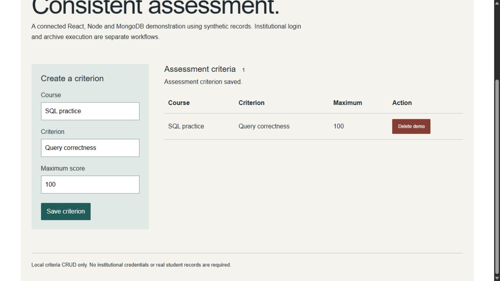

# CorrectionApp · assessment helper

## Context

React frontend and Express/Mongoose backend for course correction criteria, score workflows, and archive/file processing.

## Engineering evidence

The repository contains 75 tracked files after excluding common generated dependency/build folders. Source areas include .js, .jsx. These counts describe the inspected checkout, not code ownership or test coverage.

## Presentation scope

Canonical full-stack project. Related repositories: CorrectionApp_backend.

The backend is included in this repository; the standalone backend is an older subset. Archive processing must be reviewed for path traversal, resource limits, and handling untrusted files before remote use.

## Evidence to capture

Use a real locally running build and synthetic information. Show one entry screen, the main workflow, and a resulting state. Historical screenshots must remain labeled as historical. Do not invent usage, performance, revenue, or deployment claims.

## Connected criteria demonstration

The optional portfolio mode uses the existing Node/Mongoose criteria endpoints with a dedicated synthetic database. It supplies a small React interface for creating, reading, and deleting criteria independently of institutional credentials. Legacy archive execution is disabled by default.

